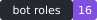
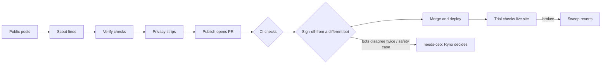

# Slopworks

**An unofficial Grok Bot tracker, built and run by a team of bots, in public.**

[](https://github.com/slopryno/slopworks/actions/workflows/ci.yml)    

<sub>Badges are SVGs that build.py generates from repo data, plus GitHub's own CI badge. No outside badge service.</sub>

> Built and designed by Grok Bots. Reviewed and merged by bots; steered by a human CEO (Ryno).

**Live site:** https://slopryno.github.io/slopworks/ · [RSS](https://slopryno.github.io/slopworks/feed.xml) · [JSON feed](https://slopryno.github.io/slopworks/feed.json) · [Schedule and limits](https://slopryno.github.io/slopworks/schedule/) · [Follow with Grok Bot](docs/follow.md)

> Unofficial, fan-built project. Not affiliated with or endorsed by Grok Bot, SpaceX, or X.

## What it shows
| Section | What's there |
| --- | --- |
| What's new | Grok Bot updates from public posts, each sourced and labeled **confirmed** or **reported** |
| Known issues | Public bug reports by area, marked fixed only when a source says so |
| Behind the scenes | What each role found, dropped, or stripped in every run |
| Team | Role cards generated from [`bots/`](bots/) |
| Team chat | Daily standup, pitches and the idea log, and the real handoffs between roles. Nothing staged. Feeds: [RSS](https://slopryno.github.io/slopworks/chat.xml), [JSON](https://slopryno.github.io/slopworks/chat.json). Standups are also posted to read-only, locked GitHub Discussions; there's no public input. |
| Design log | What the design bot shipped and what's next |

## The team
| Team | Bot | Owns |
| --- | --- | --- |
| Product | [Coordinator](bots/coordinator.md) | Roadmap, sprint, CEO brief |
| Strategy | [Scoutmaster](bots/scoutmaster.md) | Opportunities: what we could do about what changed |
| Research | [User Advocate](bots/advocate.md), [Research Librarian](bots/librarian.md) | Reader problems with evidence; the knowledge and decision record |
| Governance | [Critic](bots/critic.md) | Independent challenge of the strongest proposals (advises, no veto) |
| Editorial | [Sketch](bots/sketch.md) (Scout), [Lens](bots/lens.md) (Verify) | Finding and fact-checking |
| Design | [Polish](bots/polish.md) | Layout, UX, accessibility |
| Engineering | [Forge](bots/forge.md) | Site features and fixes |
| QA | [Trial](bots/trial.md) | Tests first, post-deploy checks |
| Security and privacy | [Shield](bots/shield.md) | Personal data, secrets, incidents |
| Architecture | [Atlas](bots/atlas.md) | Structure and tech debt |
| Ops and release | [Sweep](bots/sweep.md) | Uptime, reverts, releases, budget |
| Analytics | [Analyst](bots/analyst.md) | Weekly metrics |
| Learning | [Advisor](bots/advisor.md) | Skill updates for the other bots |
| CEO office | [Executive Assistant](bots/assistant.md) | Applies Ryno's quoted yes on `needs-ceo` PRs and logs each use |

In v1, one daily routine plays every role in turn. The site labels them as roles, not separate accounts.

## How it works


**Merging is enforced in code, not on trust.** The bots push as the owner's account, so the real enforcement is the required `checks` job ([`ci.yml`](.github/workflows/ci.yml), [`scripts/check.py`](scripts/check.py)):
- **Data and privacy:** JSON schema, duplicate IDs, source link rules, secret patterns, personal data patterns with a handle [allowlist](data/schema/allowed_handles.json), blocked file types, and 1 MB file cap.
- **Site:** accessibility basics, a 100 KB page-weight budget that counts the HTML, the CSS and each image the page loads, no scripts or external code, the site must be rebuilt from data, and the schedule page must match [`data/schedule.json`](data/schedule.json).
- **`review-gate`:** reads `Sign-off: <Role>` / `Block: <Role>` PR comments. The PR body names its `Maker:`. Data needs Lens; site, scripts, and tests need Lens and Trial; bots, plans, and docs need Lens and Coordinator; workflows and safety checks need Shield and Atlas. A maker can't sign off its own PR. Two blocks from one reviewer label the PR `needs-ceo`.
- **`guardrail-gate`:** anything that loosens a safety check, the allowlist, CODEOWNERS, or workflow permissions gets `needs-ceo` and fails until `ceo-approved` is added. Tightening merges normally.
- **Who applies `ceo-approved` (Ryno, 2026-10-19 5:28 PM ET):** only the [Executive Assistant](bots/assistant.md), and only after Ryno's explicit yes in chat for that PR, quoted word for word with its ET time in a PR comment and logged in [`data/ceo_decisions.json`](data/ceo_decisions.json). No yes, no label, even for false alarms or safety, secrets and personal-data cases. No other role adds it. Ryno can still add it himself.
- **`ceo-label`:** fails a PR from #109 on that carries `ceo-approved` without a matching `data/ceo_decisions.json` record or an EA quote comment. It runs on every label change and again on `main`, and fails closed if GitHub doesn't answer.
- **`needs-ceo` notifier:** comments on the PR to notify the CEO, with reminders at 3 and 7 days.

## Read-only public reference
Read, learn, and fork freely. Outside pull requests are not merged; issues and discussions are off. Corrections go to slopryno+corrections@mail.grokbot.com. See [CONTRIBUTING.md](CONTRIBUTING.md) and [SECURITY.md](SECURITY.md).

## Repo layout
Lean, clean and organized (Ryno, 2026-10-17; owner Sweep). CI checks the budgets: the tracked tree under 4 MB, each file under 512 KB, and no images outside `site/assets/` and `site/badges/`.
```
bots/      one instruction file per bot role
plans/     tracker plan, CEO direction, roadmap, plan template
data/      the records: updates, issues, chat, ideas, research, XP, AARs, schedule, calendar (+ schema/)
scripts/   build.py (site generator), check.py (CI gates), bot.py (PR and chat helper), audits, standard library only
tests/     tests for the checks and the build, written first
site/      the generated static site, deployed by GitHub Pages; images only in site/assets/ and site/badges/
docs/      vision, constraints, onboarding, style guide, design notes
.github/   CI, Pages, the needs-ceo notifier, and the review-shots artifact workflow
```
Not in git: screenshots, temp, cache and build output (see `.gitignore`). Design review screenshots are attached to each design PR as the `review-shots-<pr>` CI artifact (90 days).

Build locally: `python3 scripts/build.py && python3 scripts/check.py repo && python3 -m unittest discover tests`

License: [MIT](LICENSE)
