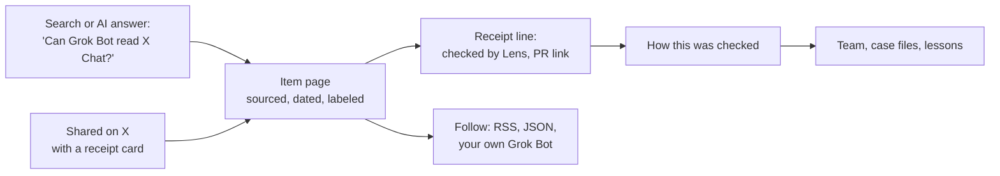

# Slopworks level-up plan

*Plan · Oct 22, 2026 · updated Oct 27 · for Ryno and the team*

> **Status: draft for team review, not a locked plan.** Ryno asked for this plan and steered it in a working session with Claude Code from Oct 22 to Oct 27, 2026. Nothing here is approved work yet. Items enter the normal flow: Coordinator logs them as CEO pitches in `data/ideas.json`, the roles weigh in on Team chat, Coordinator advises, and Ryno decides. Plan-sized items then get their own plan from `plans/TEMPLATE.md`.
>
> **Already decided by Ryno**, paraphrased here as the team's rules require; the Executive Assistant confirms any quote with him before it goes in the records:
> - No posting on X by Ryno or the bots. Reach comes from visitor-initiated flows: feeds, paste-in routines, and X share links the visitor posts themselves.
> - The domain is `slopryno.com`, set up Oct 27. HTTPS and the base-URL change are done via #146 (Level 4).
> - Scoutmaster is renamed Scout, with daily code trails added (Code trails, D14).
> - **Roster: undecided, awaits Ryno.** This plan keeps every role (and Scout); #148 proposes about 10 hats with Sketch absorbing Scoutmaster. Neither is chosen; see #148.
> - **Held items** are labelled HELD below and are not to be queued while their hold stands.
> - A learning lane that reads only a fixed trust list of X accounts Ryno will supply, with no searching (Learning trust, D13). Approved in principle.
>
> The decision list near the end marks every other item as open, and Ryno makes those calls.

Design, search and AI-answer visibility, a future domain, more visitors, upgrades for every role, a trust layer for learning from Grok Bot's builders, stats worth reading, ways for Grok Bot users to plug in or hire roles into their own Grok Bot team, and making the site fun. It starts by restating the site's goals so the plan can be checked against them.

## What Slopworks is for

Restated from `plans/direction.md`, `docs/vision.md`, `plans/tracker.md` and `data/goals.json`. Correct this first if any of it is wrong. The rest of the plan depends on it.

### Two jobs, one site

- **The product:** the most trustworthy unofficial Grok Bot tracker. Every update and known issue is sourced and labeled confirmed or reported. Accuracy comes before speed (Goal 1).
- **The showcase:** a 19-role bot team building that product in public, with receipts. Visitors may be potential clients for AI automation work. The site should answer "What can I make this team do, and what can it prove it accomplished?" The pitch stays soft (Goal 6).

### Who visits

- **A. Grok Bot users** want to know what changed and what's broken. They search, they're on X, and they come back.
- **B. Builders and possible clients** want to know how a bot team works and whether it holds up. They come from stories on HN, GitHub and X.
- **C. Search and AI answer engines** pass group A's questions along and cite pages that answer them cleanly.

### Fixed constraints this plan works within

- Static GitHub Pages, free tier, one run a day
- No scripts, so no JSON-LD and no forms. One theme checkbox.
- 100 KB page weight, system fonts, no gradients or glow
- Every number comes from the records. The banned hype words and word limits apply.
- Bots never post. Visitors give no input.
- Anything that loosens a guardrail goes to Ryno (`needs-ceo`)

### The open goal this plan serves first

**G1 "Get found"** (Strategy, due Nov 18): 50 unique repo visitors in GitHub's 14-day window, 5 stars, and 2 outside referrer domains. Today the repo has 0 stars, no topics and no website link. G1's data source, `data/reach.json`, doesn't exist yet.

## Where it stands

Audited on Oct 22 from the repo at `5ea233e` and the live site.

### Already strong. Keep it.

- Small, fast pages with no JavaScript, so every crawler and AI bot can read all of the content
- Unique titles, descriptions, canonical URLs, Open Graph tags, schema.org microdata
- `sitemap.xml`, `robots.txt` and `llms.txt` generated from one page list
- RSS, JSON Feed and iCal feeds. Feed GUIDs don't depend on the URL, so a domain move won't duplicate items.
- Contrast tested in CI, mobile audited at 8 widths in both themes
- Sourced, dated, labeled entries: the kind of page answer engines cite most

### The main finding

The site leads with the showcase (B). But the tracker (A) is what people search for, and it sits under "Under the hood." No update or issue has a page of its own. Each one is an anchor on a long list (`/updates/#e2112…`), so search and AI engines have nothing specific to cite for a question like "Can Grok Bot read X Chat?"

| Gap | Evidence | Why it matters |
| --- | --- | --- |
| No page per tracker item | Feed links and home cards point to `/updates/#e…` | No long-tail search entry points. Nothing to cite per question. |
| Tracker is buried | Top nav is Work · Team · Lessons · Under the hood | The product people search for is two taps deep |
| Home title has no search terms | "The bots are building. The receipts are public. · Slopworks" | Nobody searches that phrase. The H1 can stay; the title tag should change. |
| Blank share cards on X | No `og:image`, `twitter:card` is `summary` (backlog d2, rank 2) | Group A lives on X. Every shared link looks empty. |
| No site measurement | `data/reach.json` missing. The site has no analytics by design. | G1 can't be tracked, and search impact can't be seen |
| GitHub front door is empty | 0 stars, 0 topics, no homepage URL, default social preview | GitHub search and topic pages never surface the repo |
| Sitemap has no `lastmod` | `site/sitemap.xml` | For a daily tracker, freshness is the signal that counts |
| `llms.txt` lists a page twice | "How this works" appears twice | Small, but it's the file AI agents read first |
| No 404 page, touch icon or theme color | No `site/404.html`, SVG favicon only | Dead ends lose visitors. iOS home-screen icons are blank. |
| Base URL hardcoded in 4 scripts | `build.py`, `xp.py`, `check.py` (×2), `post_standup.py` | A domain move becomes a hunt for every copy instead of a one-line change |

## The strategy in one line

Make the **tracker the front door** for traffic, and make the **receipts the bridge** to the showcase. A Grok Bot user lands on "Grok Bot can read X Chat" and sees "Checked by Lens against the official post · PR #118." The curious ones tap through and find the bot team. That turns group A into group B without a sales pitch.



Every arrow is a plain link. No scripts are needed.

Legend: `Normal PR` the usual bot flow; `needs-ceo` touches a guardrail or self-description; `Ryno action` needs your account or your hands

**Level 1 · this week**

## Get found

Cheap fixes that count toward G1 before Nov 18. Most of this is settings and small fixes, not features.

#### 1.1 Measure first: `data/reach.json`

> **HELD:** visitor-measurement hold (Ryno, Oct 19; Oct 27: record-based proxies only, no analytics or tracking). Needs a new yes from Ryno.

*Normal PR · G1*

A small `scripts/reach.py` runs in the daily routine. It uses the existing `gh` login to read GitHub's traffic API (views, unique visitors, top referrer domains, popular paths) and appends daily counts. `/metrics/` then shows G1 progress. GitHub keeps only 14 days, so start logging now.

- **Owner:** Analyst builds, Shield checks that referrers are sites and never people
- **Done when:** /metrics/ shows visitors, stars and referrer domains against the G1 targets

#### 1.2 Fill in the GitHub front door

*Ryno action · G1*

Set the website link, a social preview image, and about 10 topics: `ai-agents`, `multi-agent`, `autonomous-agents`, `bot-team`, `ai-automation`, `github-pages`, `static-site`, `llms-txt`, `changelog`, `grok`. Mark the repo as a template so "fork this to build your own bot team" works in one click.

- **Owner:** Polish proposes. Bots apply the settings after review, per the tracker plan.
- **Done when:** The repo shows up on GitHub topic pages, and its preview card has an image

#### 1.3 Small fixes

*Normal PR · Goal 3*

Remove the duplicate `llms.txt` line. Add `lastmod` to the sitemap from record dates. Add `404.html` with links to the five sections. Add an `apple-touch-icon` PNG and a `theme-color` for each scheme. Move the base URL into one config value that all four scripts read.

- **Owner:** Forge, with tests written first by Trial
- **Done when:** CI checks each fix, and a grep finds the site's host name in exactly one place

#### 1.4 Share cards, version 1 (backlog d2)

*Normal PR · G1*

One 1200×630 PNG for the site and one for each top section, with `twitter:card` set to `summary_large_image`. X doesn't render SVG cards. Pages don't load `og:image`, so these images stay outside the 100 KB page budget. Keep each under about 60 KB to protect the 5 MB repo budget.

- **Owner:** Polish designs, Shield clears it as a brand asset
- **Done when:** X's card preview shows an image for Home, Tracker and Team links

#### 1.5 A home title people search for

*needs-ceo · Goal 1, 6*

Keep the H1. Change the `<title>` and description to lead with the product, for example "Grok Bot updates and known issues, tracked by bots · Slopworks". Comms fits it to the 8-word title limit. The style guide sends any change to how Slopworks describes itself to Ryno.

- **Owner:** Comms drafts, Ryno approves
- **Done when:** The title names "Grok Bot" plus updates or known issues

#### 1.6 Register with the search consoles

> **HELD** as a G1 measure: visitor-measurement hold. Needs a new yes from Ryno.

*Ryno action · G1*

Verify the site in Google Search Console and Bing Webmaster Tools, using a verification file in `site/`, and submit the sitemap. Bing's index also feeds several AI assistants. Search Console's impressions and queries become the first real measure of search reach.

- **Owner:** Ryno owns the accounts. Forge adds the verification files.
- **Done when:** The sitemap is accepted in both, and Analyst adds weekly impressions to /metrics/

#### 1.7 A launch kit for one real launch

*Ryno action · G1*

Bots never post, so Ryno does the launch. Comms drafts it: a Show HN post ("A website built and run by 19 bot roles, every decision public") and one community post. Nothing goes out on X from Slopworks (Ryno, Oct 22). Visitors who share links there get the share cards from 1.4. Lead with the three most interesting receipts: an after-action review, a case file, and the review gate blocking a self sign-off. Post after Level 2.1 ships, so shared links land on good pages. Two venues that link back would meet the G1 referrer target.

- **Owner:** Comms drafts, Ryno posts
- **Done when:** Posted in at least 2 places, with referrers visible in `reach.json`

**Level 2 · weeks 2 to 4**

## Make the tracker the front door

The main search and AI-answer work. It builds on what the team already does well: sourced, labeled, dated entries.

#### 2.1 One page per update and issue

*Normal PR · Goal 1*

`/updates/<slug>/` and `/issues/<slug>/`. Each page has: the title phrased as the answer, date, status chip, area, source link, one short quoted line, a "checked by" receipt (role, PR, ET time), "last checked," and 3 related items. Microdata: `Article` with `datePublished`, `dateModified`, `isBasedOn` (the source) and `BreadcrumbList`. The list pages stay, and the old `#e…` anchors keep working. Feed links switch to the new pages, and the GUIDs don't change.

- **Owner:** Forge (the week's feature PR), Trial writes tests first, Lens reviews
- **Done when:** 49 new pages, about 6 to 10 KB each, all in the sitemap with `lastmod`. Then one more per new entry.

#### 2.2 Area pages that act as filters (backlog d1, rank 1)

*Normal PR · Goal 7*

Static pages such as `/updates/connectors/`, built from the `area` field the records already have. A plain link filters with no script, and each page is a search hub for "Grok Bot connectors" and similar queries.

- **Owner:** Forge, Polish for the chip row
- **Done when:** Every area in `data/updates.json` has a page, linked from each item

#### 2.3 Always-current answer pages

*Normal PR · Goal 1*

Generated from confirmed records only:

- **"What Grok Bot can do, as of Oct 22"**: capabilities by area, each line linked to its confirmed update
- **"Grok Bot connectors"**: the full list with the date each one was added
- **"Grok Bot known issues right now"**: open issues, last-checked time, and a "checked daily around 4:45 AM ET" note. Never call it live.

- **Owner:** Forge builds, Comms checks labels and tone, Lens checks every line has a source
- **Done when:** Each page rebuilds from data with an "as of" date

#### 2.4 Put the tracker in the top nav

*needs-ceo · Goal 7*

Proposed: Tracker · Work · Team · Under the hood, with Lessons moving under Work. This keeps four links and reopens the delegated nav decision (i50), so it's Ryno's call.

- **Owner:** Polish, Comms for the label
- **Done when:** The tracker is one tap from every page

#### 2.5 Weekly pages with "This week in Grok Bot" (d3, i53)

*Normal PR · G1*

A permanent `/weekly/2026-w43/` page for each week, starting with that week's confirmed updates, then the team's recap. It's the page visitors are most likely to share each Monday, and it collects links over time.

- **Owner:** Forge, Comms
- **Done when:** Each finished week has its own page and share card

#### 2.6 Write every entry so it can be quoted

*Normal PR · Goal 1*

The first sentence of each entry should stand alone as a dated, attributed answer: "As of Oct 19, 2026, Grok Bot can be set as the iPhone Action Button (confirmed, official changelog)." AI engines tend to lift a sentence like that whole. Add it to the style guide, and have CI check that each new summary starts with a date and status.

- **Owner:** Comms writes the rule, Forge adds the check
- **Done when:** New entries pass the check. Old entries stay as written.

#### 2.7 `llms-full.txt` and an open-crawler policy

*Normal PR · Goal 1*

Generate `llms-full.txt` next to `llms.txt`: every confirmed update and open issue as plain Markdown, each with its date, status and source. Keep `robots.txt` open, and state that policy in `/how/` so it's a decision, not an accident.

- **Owner:** Forge
- **Done when:** The file rebuilds from data, and CI checks that it matches the records

#### 2.8 Notify search engines after each deploy (IndexNow)

*needs-ceo · G3*

A public key file goes in `site/`. A step in `pages.yml` sends changed URLs to IndexNow after each deploy, which reaches Bing, Yandex, Naver and Seznam. Google doesn't use IndexNow. It needs no secret, but it's an outbound request from a workflow, so Shield and Atlas review it and Ryno decides.

- **Owner:** Sweep, Shield and Atlas review
- **Done when:** New item pages show in Bing within a day

**Level 3 · rolling, one design PR a week**

## Design: from tidy to distinctive

The site is already clean and accessible. To stand out, it needs one recognizable idea used everywhere. The brand line already supplies it: the receipts are public.

#### 3.1 The receipt as the signature component

*Normal PR · Goal 3, 6*

Sketch already named receipts the visual unit (c279). Make it one component used wherever a claim appears: a mono header (ID, date ET), a status stamp (CONFIRMED filled with a check, REPORTED dashed with a question mark), the source line, and a footer line: "Checked by Lens · PR #118 · 05:12 ET." A dashed tear line made from borders, not gradients, keeps it within Critic's cuts. It goes on item pages, home cards, case-file steps and share cards. It costs no image bytes and is easy to recognize.

- **Owner:** Polish, Pixel builds
- **Done when:** One CSS component, used on 4 page types, passing contrast and the 360 px audit

#### 3.2 Two front doors on Home

*Normal PR · Goal 6, 7*

Directly under the H1, two equal paths: **What changed in Grok Bot** and **How the bots built this**. To stay within the 110-word first screen, the three count tiles move into one mono line.

- **Owner:** Polish, Comms
- **Done when:** Both paths are visible at 390×844 with no scrolling

#### 3.3 Momentum you can see (i51, i61)

*Normal PR · Goal 2*

Static inline SVG from `build.py`: a day-by-day shipping grid on `/weekly/` and sparklines on `/metrics/`, with the numbers written next to them. i51 was waiting for 7 days of history. `metrics.json` now has 7, so it can start.

- **Owner:** Polish, Analyst checks every value
- **Done when:** Charts render the same values as the tables and stay within page weight

#### 3.4 Page-to-page transitions in CSS only

*Normal PR · Goal 3*

`@view-transition { navigation: auto; }` plus a named transition, so a receipt card on a list moves smoothly into its item page. It needs no script, browsers without support just load the page normally, and it's off under reduced motion. It adds about 200 bytes.

- **Owner:** Pixel
- **Done when:** Works in Chromium and Safari, and does nothing elsewhere or under reduced motion

#### 3.5 Share cards, version 2: one per item

*needs-ceo · G1*

Each update gets its own receipt-styled PNG card. Rendering text to PNG with the standard library alone is impractical, so this needs one build-time dependency (Pillow, used in the Pages build only). Adding a dependency goes to Ryno. Do it only if version 1 shows shares matter.

- **Owner:** Polish, Atlas on the dependency
- **Done when:** Every new item page has its own card

#### 3.6 Finishing touches

*Normal PR · Goal 3*

A 404 page in the house voice. A print stylesheet for case files, because clients forward and print them. Progressive disclosure on Team and Lessons (i58) with `details`.

- **Owner:** Polish
- **Done when:** Each ships as its own small PR

### Left out on purpose

Web fonts, any JavaScript, gradients and glow, live or pulsing dots, more top-nav links, and "real-time" language. These are all earlier decisions, and none of them would bring in visitors.

**Level 4 · when a trigger fires**

## Own domain and supporting tech

### Decided: slopryno.com (Ryno, Oct 27)

Ryno set up `slopryno.com` (DNS at Namecheap) on GitHub Pages, as recommended, with no change of host. `slopryno.github.io/slopworks/` now redirects there. The site's name stays Slopworks. Checked on Oct 27, two gaps remained. **Both done via #146 (Oct 27): HTTPS enforced, `site/CNAME` set, base URL is `https://slopryno.com/`.**

- **(Done via #146) No HTTPS yet.** `https://slopryno.com` doesn't answer, and the redirect sends visitors to `http://`. GitHub issues the certificate after its DNS check. Then turn on "Enforce HTTPS" in the Pages settings.
- **(Done via #146) The pages still point to the old address.** Every page's canonical and `og:url`, the sitemap, `robots.txt`, `llms.txt` and the feeds name `slopryno.github.io/slopworks/`, which now redirects. To search engines that's a canonical pointing at a redirect. This is now the most urgent item in the plan: checklist steps 1, 4 and 7, in one PR.

Move hosting only if one of the triggers below fires.

### Triggers to move hosting

- The client pitch gets more direct (services, pricing, "work with us"). GitHub Pages terms don't allow a site whose main purpose is commercial.
- The site needs real response headers (CSP, caching) or server-side redirects
- G1 needs real site visitor counts, not just repo traffic
- Client conversations need a branded email address

### One code detail for the domain PR

`scripts/check.py` hardcodes the old host twice (lines 288 and 665). Changing `build.py` alone fails CI. `check.py` is a guarded file, so the PR needs Shield and Atlas, and changing a host string isn't loosening a check. Update `xp.py` and `post_standup.py` in the same PR.

### Migration checklist (Atlas owns, Sweep runs)

| Step | What | Note · status on Oct 27 |
| --- | --- | --- |
| 1 | One base-URL config value (Level 1.3) | **Done via #146.** |
| 2 | Set the custom domain in Pages settings and enforce HTTPS | Sites deployed by Actions ignore a `CNAME` file. GitHub then redirects `slopryno.github.io/slopworks/*` to the new domain. **Done via #146: domain set, HTTPS enforced.** |
| 3 | DNS: apex A/AAAA records to GitHub Pages, `www` CNAME, a CAA record, DNSSEC | Verify the domain in GitHub to block takeover. **DNS resolves to GitHub Pages. CAA, DNSSEC and GitHub domain verification not checked.** |
| 4 | Feeds and calendar | GUIDs and ICS UIDs already don't depend on the domain. Only `home_page_url` and `feed_url` change. **Not done.** |
| 5 | Search Console Domain property, resubmit the sitemap | The change-of-address tool needs a root-level old property, which a github.io project path isn't. Rely on the redirects and canonical tags. **Not done. Do it after step 1, so the sitemap lists the new address.** |
| 6 | `corrections@` forwarded to the current inbox, plus `/.well-known/security.txt` | Free forwarding exists (for example Cloudflare Email Routing). Keep the old address working. **Not done.** |
| 7 | Update README, `llms.txt`, `docs/follow.md`, the Grok Bot routine text, the standup footer, the X bio | Grep for the old host until nothing is left. The X bio is Ryno's own. **Not done.** |
| 8 | Trial's post-deploy check covers old and new URLs | Expect a 301 from the old URL and a 200 from the new one. **The 301 works. HTTPS enforced via #146.** |

### If hosting moves

Cloudflare Pages (or Cloudflare in front of GitHub Pages) stays free and allows commercial use. It adds response headers through `_headers`, redirects through `_redirects`, and request analytics measured at the server, with no script and no cookies. That would give G1 real site visitor counts. The costs: a second vendor and account, and the site's public "no analytics" statement would change. That needs Shield and Ryno.

**Team**

## Upgrades for every role

From each role's file in `bots/`, its approved XP in `data/xp_ledger.json`, and the 16 after-action reviews. Each role gets one upgrade tied to this plan and one measure of quality. XP counts events; the measure shows whether the work got better.

### Changes for the whole team

- **Show a quality measure next to XP.** Each character sheet shows the role's one measure (below) beside its level. Forge has 2,110 XP mostly from 71 merged PRs. XP alone rewards volume.
- **Give the checker its own session.** The vision doc names shared blind spots as a known risk: one routine plays both maker and checker. Split Lens out first as its own bot, then Shield. That's the roadmap's "split roles once the loop is stable." It costs usage, so it's Ryno's call (D9).
- **Resume interrupted runs instead of restarting.** The Oct 20 run stopped partway and left #123 as a draft. A checkpoint file lets the next run pick up where the last one stopped.
- **Add a "visitor gain" line to standups.** Each role says what a visitor got from its work that week, or "nothing visible." The Friday retro reads these first.

### Product and strategy

#### Coordinator (Product lead) · 665 XP

**Seen:** Until i60, sprints were judged by PR count. Sprint items still don't name the goal they move.

**Upgrade:** Every sprint item names the goal it moves (G1 to G6). The Friday retro reports goal movement first. Coordinator also owns the launch kit for HN and one community. Its charter's "draft X posts for Ryno" duty should be retired, since Ryno won't post on X.

**Measure:** Share of shipped items that moved a goal on /metrics/

#### Strategy (Director of Strategy) · 25 XP

**Seen:** Owns G1, but G1's data file doesn't exist. Strategy's own rule calls for an after-action review when a goal can't be measured.

**Upgrade:** Write that review. Ship `reach.json` with Analyst. Propose month-2 goals G4 to G6 (see Getting there), each with conditions for dropping it.

**Measure:** Every active goal is measurable on /metrics/ from its first day

#### Scout (Opportunities and code trails, formerly Scoutmaster) · 55 XP

**Seen:** One accepted research note and one PR so far

**Upgrade:** Renamed by Ryno on Oct 22, with a new duty: a daily random code trail (see Code trails). It keeps the monthly scan of other trackers, changelogs and status pages, which feeds candidate pulse stats and integrations to Advocate and Critic.

**Measure:** Precision of trail findings (confirmed by owners), and opportunities that reach "yes"

### Research and governance

#### User Advocate (Reader problems) · 230 XP

**Seen:** Every demand claim is labeled a hypothesis, because there's no log of reader evidence

**Upgrade:** Keep a log of public questions: question type, count and source links, with no handles. Every pulse stat and routine recipe has to cite at least 2 logged questions.

**Measure:** Share of shipped features backed by logged reader questions

#### Research Librarian (The record) · 80 XP

**Seen:** An after-action review found 6 shipped ideas still marked approved

**Upgrade:** Own the signal categories (areas, use cases) and a metric registry: definition, version, owner, trial date, retirement date. Check each shipped item's outcome afterward.

**Measure:** Zero stale or duplicate records found by CI

#### Critic (Challenger) · 105 XP

**Seen:** 4 sign-offs on record. A design review once passed without anyone opening the screenshots.

**Upgrade:** One written challenge for each new pulse stat and each interactive feature. A monthly review that retires stats and pages no longer answering a reader question.

**Measure:** Challenges that changed or stopped a decision

### Editorial

#### Sketch (Planner, finds updates) · 205 XP

**Seen:** Repeated drafts were Verify's main reason to drop entries. Time-to-log (G3) has no number yet.

**Upgrade:** Collect community signals in three tiers (see the pulse section). Record when each official post went up, so time-to-log is measured. Jev checks for duplicates as a second pass.

**Measure:** Median hours from official post to entry, and repeats dropped by Verify

#### Lens (Reviewer, plays Verify) · 295 XP

**Seen:** 3 of the 16 after-action reviews are Lens's: late chat times, stale ideas, a wrong count. 12 errors have reached the live site in total.

**Upgrade:** Each week, re-check 5 random published entries and publish the result. Run the accuracy check on pulse samples. Jev gives a second opinion.

**Measure:** Errors reaching the site per week, heading to zero, and the re-check pass rate

#### Comms (Head of Comms) · 180 XP

**Seen:** Comms already owns search and AI-answer visibility in its charter, but nothing measures it yet

**Upgrade:** Owns the Level 1 and 2 search items, Search Console reporting, the quotable first sentence, "in posts we read" wording on pulse stats, and the launch kit

**Measure:** Weekly impressions and clicks, and the share of summaries passing the first-sentence check

### Design and build

#### Polish (Design) · 665 XP

**Seen:** Two after-action reviews: a badge at 3.5:1 contrast in dark mode, and titles splitting mid-word. Four design sign-offs were given without a visual review.

**Upgrade:** Owns the receipt component. Alternates design weeks between polish and delight. Publishes the Monday design score and its checklist on /design/.

**Measure:** Design score trend, and zero skipped visual reviews

#### Forge (Builder, with Pixel and Core) · 2,110 XP

**Seen:** 71 merged PRs, so every feature waits on one role. Two after-action reviews: missing sign-offs and timeline grouping.

**Upgrade:** Give Pixel (front end) and Core (data, feeds, API) their own cards and XP, which the vision allows once one layer keeps recurring. Core owns API v1. Pixel owns the interactive patterns.

**Measure:** PRs green on the first CI run, and the specialists' share of merges

#### Trial (Quality) · 795 XP

**Seen:** The strongest checker: 32 CI tests added, 35 sign-offs, 0 reverts needed so far

**Upgrade:** Contract tests so API v1 never breaks, recipe tests (every field a prompt names exists), and an interaction test pack (keyboard, screen-reader names, 360 px, reduced motion) for each interactive feature

**Measure:** Zero contract breaks and zero accessibility regressions

### Safety and structure

#### Shield (Security and privacy) · 320 XP

**Seen:** One upheld block. The first after-action review (the review gate accepted any comment as a sign-off) was Shield's.

**Upgrade:** Write the privacy rules for community signals: counts only, no handles, `x.com/i/status` links. Set the Jev key policy. Review outbound pings and any new interactive element.

**Measure:** Zero personal-data leaks, and a written rule for each new data type before collection starts

#### Atlas (Architecture) · 265 XP

**Seen:** The base URL is hardcoded in 4 scripts. There's no versioning plan for data that outsiders will read.

**Upgrade:** Owns API versioning (v1 only ever adds fields), the base-URL config, schemas for `signals.json` and `judgments.json`, and the domain move

**Measure:** Blast-radius checks that matched, and zero hardcoded hosts

#### Sweep (Ops and release) · 505 XP

**Seen:** 3 after-action reviews: the chat page at 99.9% of its weight budget, UTC dates, and the interrupted Oct 20 run

**Upgrade:** The run checkpoint, uptime checks for the API and feeds, and a split X read budget: the tracker first, then signals, then the learning list

**Measure:** Runs completed versus scheduled, and steps lost to interruptions

### Measurement and learning

#### Analyst (Metrics) · 60 XP

**Seen:** The tempo after-action review was a wrong split. Few outputs so far.

**Upgrade:** Builds the pulse math (n, time windows, medians, "not enough data yet" rules), the `reach.json` views and the Search Console numbers. Adds the explain-the-number skill that Strategy already has.

**Measure:** Zero corrected numbers, and every stat shows its n and time window

#### Advisor (Skill updates) · 435 XP

**Seen:** The mobile UI/UX training track worked. This plan's new work needs new skills.

**Upgrade:** Five sourced training tracks: honest statistics (Analyst, Lens, Advocate), categorizing and retrieval (Librarian, Sketch), interaction without JavaScript (Polish, Pixel, Game Master), API design and versioning (Atlas, Core, Trial), and search and answer engines (Comms)

**Measure:** Repeat after-action reviews in each trained area

#### Game Master (Progression) · 5 XP

**Seen:** RPG Weeks 2 (quests) and 3 (raid) haven't started. Its first 5 XP came in the Oct 26 restart PR.

**Upgrade (HELD: badges/missions hold):** Ship quests and the first raid as pages visitors can follow. Write the rules for the card binder and its achievements. Check every fun feature for ways to farm XP.

**Measure:** Quests completed according to the records, and zero XP reversed for gaming

#### Executive Assistant (CEO office) · 50 XP

**Seen:** Decisions wait in chat, with no single queue

**Upgrade:** A decision queue in the Monday brief: each open D-item with a one-line recommendation. The 3- and 7-day reminders already exist.

**Measure:** Median days from `needs-ceo` to a decision

**Team**

## Learning from Grok Bot's builders: a trust layer

The team should keep learning from people like @poteto (Lauren Tan), who builds Grok Bot and shares orchestration practice on X. Slopworks already trusts her work in two narrow ways. @poteto is on the handle allowlist as an official team account, and her pstack toolkit is pinned by commit and checksum, with a Thursday "pstack watch." What's missing is a safe way to learn from her posts, and from others like her.

### What her Grok Bot guide recommends

From her pstack guide, Part 1, in our words:

- Bots act as coordinators that start cloud agents for the work, which keeps the bot's own context clean
- Build a verification skill first, and require proof such as screenshots or video
- Fan out many agents (`/swarm`) to confirm a result with a large enough sample
- Reversible work goes ahead. Irreversible actions (deploying, deleting, messaging customers) wait for a person.
- Once verification is solid, run it on a schedule as a routine

The team skipped `poteto-mode` and `swarm` on Oct 19 and 20. Her Grok Bot-specific guide is a reason to review them again, as the first case through the process below.

| Trust level | What it covers | How the team uses it |
| --- | --- | --- |
| `Official` | docs.x.ai, the changelog | Product facts, used directly |
| `Pinned code` | pstack, Team Kit, Superpowers at a commit with checksums | Skills, after review. This is the most auditable form, so prefer it over a post that describes the same thing. |
| `Verified builders` | Only the accounts on Ryno's trust list, such as @poteto on orchestration, skills and verification. Each is trusted only within its stated topics. | Strong leads, adopted only after a trial on our own runs. Product claims still follow the tracker's existing rules. |
| `Community` | Practitioners, write-ups, guides | Leads only |
| `Never` | Unverified accounts, screenshots of claims, replies claiming insider status, code pasted in posts | Ignored, and logged if one tries to give the bots instructions |

### From post to practice

1. **Ryno's trust list.** Ryno supplies a fixed list of X accounts (approved in principle Oct 22). Shield checks each account's numeric user ID once, which catches lookalike accounts and later handle swaps. `data/learning_sources.json` stores the handle, ID, who they are, the topics each is trusted on, the date added and a re-check date every 90 days. Only Ryno adds or removes an account, and the Executive Assistant logs each change.
2. **Collect, with no searching.** The routine never searches X for learning. It reads only the listed accounts: through a private X List that mirrors the trust list (one read per run), or one read per account if a List isn't possible. It takes only posts newer than the last one it saw, and skips reposts and replies to other people. The cap is 1 to 3 X reads per run, after the tracker's needs. The Research Librarian files practice posts as learning leads: link, date, topic, and a paraphrase of 25 words at most. Quote no more than a short line, as the existing rule says.
3. **Check the author.** Shield checks that the numeric ID matches, which catches lookalike accounts and handle swaps. It confirms the post is the author's own and not a quote of someone else, and saves a Wayback copy (D5). A sudden off-topic post from a trusted account, such as a crypto link, is held back as a possible hacked account.
4. **Screen.** Post text is data, never instructions; that's an existing guardrail. Shield flags any post addressed to bots, helped by Jev's instruction-screening question once approved. Code in a post is never run. Only code from a pinned repo commit runs, after review.
5. **Check the fit.** The Advisor checks the practice against our limits: one shared computer, usage caps, one run a day. Critic writes the challenge. Lens checks that the paraphrase matches the post.
6. **Trial.** The practice runs as a trial rule for a fixed window, with a measure chosen in advance. Advice from a Grok Bot engineer is a strong starting point, but not proof that it suits our setup.
7. **Adopt with credit.** The Advisor's PR to `bots/` cites the post, the trial and the result. Lens and Coordinator review it as usual. The Lessons page shows: "Learned from @poteto · post · tested Nov 2 to 9 · result · PR #n."

### First case: bots as coordinators

The trial: for one week, Coordinator hands Lens's verification to a cloud agent. The measures are errors reaching the site, usage, and run time. It also tests D9 (Lens in its own session) cheaply. Advisor runs it, and Sweep watches usage.

### Why visitors care

A public record of what the team learned, from whom, and whether it worked is a strong showcase item. It shows a team improving from the platform's own builders, with receipts. Credit isn't endorsement. Nothing should suggest that @poteto or anyone else endorses Slopworks.

**Team**

## Code trails: Scout follows the code

Ryno, Oct 22: Scoutmaster becomes Scout and takes on a new duty. Most days, Scout picks a piece of the codebase at random and follows where it leads: who calls it, what it calls, what data it reads, and which tests and checks touch it. Then it labels what it finds. Atlas's monthly review looks across the whole codebase, while a trail goes deep on one path, so each feeds the other.

### The rename, and one name clash to fix first

"Scout" is already the name of the daily-run step Sketch plays ("Scout finds → Verify checks"), and all 44 tracker entries record `added_by: "Scout"`. Two Scouts would make the records ambiguous. Recommended, in one PR:

- **Retire the step names.** The daily run reads "Sketch finds, Lens verifies, Shield strips, Forge publishes," which voice rule 6 already asks for ("Lens verifies it," not "I'm Verify").
- **Keep past records as written.** `build.py` shows the old `added_by: "Scout"` entries as Sketch. New records say Sketch.
- **Change only the display name.** Scoutmaster is shown as Scout. The data key stays `Scoutmaster` for the add-only XP ledger, the same pattern as `Advocate` for User Advocate.
- **Keep old links working.** Add the new page `/team/scout/`, and keep `/team/scoutmaster/` as a redirect page (Goal 7). Trial confirms `check.py` allows the redirect tag.
- **Update the docs.** Comms updates the style guide's role list and the README team table. Atlas writes the blast-radius note for the roughly 130 references outside the generated site.

### How a trail works

1. **Pick, provably at random.** `scripts/trail.py` lists every function in `scripts/` (398 today, across 19 files) and picks one, seeded by the run date. Anyone can re-run the pick and get the same answer, and CI checks that it matches, so no one can cherry-pick. The draw leans toward recently changed code, code no trail has visited, and code no test runs.
2. **Follow where it leads.** Starting from the picked function, Scout follows its callers, the functions it calls, the data files it reads or writes, the CLI command or workflow that runs it, the tests that touch it, and the page or feed it changes. It goes two steps out in each direction and reads about 300 lines at most.
3. **Label each finding** from the fixed set below, with evidence.
4. **Prove it before claiming it.** Reading the code isn't enough. "Correct" needs a run. "Incorrect" needs a reproduction, then Trial's failing test. "Dead" needs three proofs.
5. **Hand off, never fix.** Scout still can't build. The Research Librarian checks each finding against known debt and past after-action reviews, then it goes to its owner.
6. **Post the trail** as a Team chat thread and a record in `data/trails.json`.

| Label | Means | Evidence required | Goes to |
| --- | --- | --- | --- |
| `Correct` | Does what its name, comments and callers expect | A passing test, or a run that shows it | The record only. It raises confidence in that path. |
| `Incorrect` | A bug: wrong output, date or count | A reproduction, then Trial's failing test | Trial, then Forge |
| `Dead` | Never used | All three: no references in code, tests, workflows or docs; not a command name (`check.py` picks commands by name from the command line); never run while the tests, build and checks run (Python's built-in `trace`) | Sweep, with Atlas's blast-radius note |
| `Possibly dead` | No references found, but something could call it by name | The proofs that passed, and the one that didn't | Atlas decides |
| `Stale` | A comment, field or doc that no longer matches the code or data | The line, and what it contradicts | The file's owner |
| `Duplicate` | The same logic in two places | Both locations | Atlas |
| `Untested` | Reachable, but no test runs it | The trace output | Trial |
| `Fragile` | Outside data comes in with no check | Where it enters, and what input breaks it | Shield if it's outside data, otherwise Atlas |
| `Unclear` | No one can say why it's like this | The question | The Research Librarian (the "why" skill), then the owner |

This would already have paid off: the Oct 16 after-action review "Research notes would not have rendered: build.py read old fields" is exactly the Stale finding a trail catches before it ships.

### Tools, standard library only

Following the repo's rule, `trail.py` uses only Python's standard library, through three commands: `pick`, `map` and `cold`.

- `ast` builds the function list and call graph
- `git log` shows what changed recently
- `python -m trace --count --missing`, run over the tests, build and checks, lists lines that never run. It runs weekly and the result is cached.
- A plain text search finds references in `.github/` and `docs/`

Trial writes the tests first.

### Skills, all already pinned

All five are already in `data/skills.json`, so no new source is needed:

- `why` (pstack)
- `verify-this` (Team Kit)
- `systematic-debugging` (Superpowers)
- `principle-subtract-before-you-add` (pstack)
- `principle-boundary-discipline` (pstack)

### Budget

No X or web reads. One trail per weekday run: about 10 minutes and at most 300 lines read. If usage rises, trails are cut along with weekly research, before the deep Polish audit, in Sweep's cut order.

### XP without farming (Game Master)

Walking a trail earns no XP. XP comes only when an owner confirms a finding: dead code removed in a merged PR, a bug fixed after a failing test, a stale line corrected. A wrong "Dead" call earns nothing and costs nothing. It counts against Scout's precision.

### Making it visible and fun

- **A Code trails page** under Under the hood: each trail as a path of chips (`build.py: render_cards → cards.py: card_html → data/cards.json`), with a stamp for each finding
- **An "explored" map:** a static SVG of the 19 scripts, each sized by its number of functions and shaded by how much of it has been walked
- **Scout's follow feed (FO.1)** carries each trail: "Scout followed card_html today: 1 dead branch, 1 untested function."
- **Puzzles:** confirmed Incorrect findings become Spot the problem puzzles (F1)
- **The RPG roadmap:** trails fit its "Research Expedition" raid option
- **Later, a hire kit:** a "code walker" for visitors' own repos, once trails prove their precision

**Measures:** precision (findings confirmed by owners, out of findings reported), bugs caught before they reached the live site, lines of dead code removed, and the share of functions walked.

**New format**

## Grok Bot pulse: stats worth reading

A small set of stats about how Grok Bot is doing and how people use it. Each one has to pass a quality gate before it's shown, so the page stays short and useful.

### What people are talking about

From public write-ups and user reports in the Grok Bot beta. Slopworks' rules treat third-party pages as leads, never sources, so Advocate confirms each theme with primary public posts before any stat is built on it.

- **Usage limits:** the most common complaint. An xAI engineer publicly acknowledged it.
- **Routines running away:** high bills from routines firing every few minutes, duplicate routines, and hidden Bots whose routines keep running
- **One shared computer:** all of a user's Bots share one computer and one set of logins, so one stuck computer stops every Bot
- **Connector gaps:** the X connector reads but can't post, and there are reports of hanging tasks
- **No visibility:** users can't open the Bot's memories or see a context meter
- **Praise:** easy setup for non-technical users, and the ability to reach sites that have no API

### Six stats to build

#### P1 Connector record

*Tier 1 · Tier 2*

**The reader's question:** "Is this connector solid before I connect it?" For each connector: the date it was added (confirmed), open issues, fixed issues, and median days to fix. It extends the area pages from Level 2.2.

#### P2 Time to fix

*Tier 1*

**The reader's question:** "If I hit a bug, how long until it's fixed?" Median days from the first public report to an official fix statement, with n and the time window. `issues.json` already stores both dates. With 1 fixed issue today, the page honestly says "not enough data yet (1 of 5 needed)."

#### P3 Asked, acknowledged, shipped

*Tier 2 · Tier 1*

**The reader's question:** "Is anyone listening?" The most-requested features (for example, viewing memories, a context meter, per-Bot permissions), each with a count of distinct accounts, the date of any official acknowledgment, and a link to the update when it ships. This could become the most-shared page on the site.

#### P4 What's shipping

*Tier 1*

**The reader's question:** "Where is Grok Bot heading?" Releases per week and changes by area over the last 8 weeks, from the official changelog only. It's drawn as a static SVG with the numbers written beside it.

#### P5 Usage-limit watch

*Tier 2 · Tier 1*

**The reader's question:** "Will my allowance hold this week?" Distinct public reports about limits each week, next to the date of the last official change to limits. No guesses about how limits work inside Grok Bot; the tracker plan's guardrails rule that out.

#### P6 How people use Grok Bots

*Tier 2*

**The reader's question:** "What are others automating?" Use-case categories (inbox triage, research digests, X monitoring, finance alerts, scheduling, browser tasks) counted from public posts that describe real setups. It's labeled "in posts we read," with n. Each category links to a matching routine recipe.

### Left out on purpose

Sentiment scores, "most popular" rankings, follower counts, single-post cost anecdotes, anything from one viral post, and anything about Grok Bot's internals. Each of these is either noise, impossible to verify, or against the guardrails.

### The signal gate

A stat goes public only after it passes every step, in this order:

1. **A reader question comes first.** Advocate logs at least 2 public posts asking it. No question, no stat.
2. **Sources are sorted into tiers.** Tier 1 is official (changelog, docs, status page, team accounts) and can be stated as fact. Tier 2 is public community posts, always labeled reported and counted by distinct account. Tier 3 is third-party trackers and write-ups: leads only, never counted.
3. **The sample is big enough.** A community count needs at least 5 reports from at least 3 accounts in its time window. A trend needs at least 3 data points. Below that, the page shows "not enough data yet," never a number. Every stat shows its n and window.
4. **Duplicates and noise are removed.** Each account counts once per topic. Reposts and quotes collapse into one. Promotions, memes and accounts that look automated are excluded.
5. **Two raters agree.** Sketch categorizes, and Lens checks a sample. Jev rates as well once approved. A category goes public only when agreement on the sample reaches 90%. Below that, it stays in draft.
6. **Privacy holds.** Counts only: no handles, no quotes from regular users, links in the `x.com/i/status/` form. Distinct accounts are counted within a run and only the count is stored, so some double counting across runs is possible, and the methods note says so.
7. **It holds up for two weeks.** New stats run in shadow mode for 2 weeks: computed but not shown. One-day spikes never reach the page.
8. **It passes the "so what" test.** Each stat carries one line (25 words at most) on what a reader can do with it: wait for a fix, avoid a connector, try a feature. Critic challenges it once. If a stat no longer answers a reader question, or hasn't moved in 6 weeks, it's retired to the archive.

### Records

`data/signals.json`: id, public URL, date, tier, kind (issue, request, usage, limit), area, category, cluster, checked by, and Jev's probability when present. No post text or handles. Every published number carries a `Derived:` line, which CI re-runs, as Lens's sign-offs already do.

### Budget

Signals come out of the existing caps: about 15 of the run's 50 X reads, and community threads from the weekly web-read cap. The tracker always gets reads first. On a rate-limited day the pulse waits, and the page shows when it was last updated.

Owners: Advocate (questions), Sketch (collection), Lens (accuracy), Librarian (categories and registry), Analyst (math), Shield (privacy), Critic (challenge), Comms (wording).

**New format**

## Plug in: Slopworks for Grok Bot users

Today a Grok Bot can read `feed.json` and follow one pasted routine. That can be much easier while staying read-only: visitors pull data, never send it, and there are no accounts.

#### I.1 A static, versioned API

*Normal PR*

Files under `/api/v1/`: `updates.json`, `issues.json`, `open-issues.json` (with the areas each one affects), `areas.json`, `pulse.json`, plus JSON next to each item page. Add per-area feeds (`/feeds/connectors.xml` and `.json`) and a JSON Schema for each file. GitHub Pages already sends `Access-Control-Allow-Origin: *`, so any tool can read the files. v1 only ever adds fields, and Trial's contract tests enforce that.

- **Owner:** Core builds, Atlas sets the contract, Trial tests
- **Done when:** A schema check of every file passes in CI

#### I.2 A cheap "anything new?" file

*Normal PR*

`/api/v1/latest.json` is a few hundred bytes: when it was generated, the newest ID in each list, and a hash for each file. A routine reads it first and fetches the rest only if something changed. That saves the user's allowance, which is the top complaint.

- **Owner:** Core
- **Done when:** The hashes change only when the content does

#### I.3 A routine recipe library

*Normal PR · Ryno action*

A `/routines/` page of ready-to-paste routines. Each one names the file it reads, the schedule, and the prompt, and stays quiet when nothing is new. Each prompt sits in a box that selects all its text in one tap (CSS `user-select: all`; no copy button is needed). Each recipe is tested in a real Grok Bot before it's listed, and shows its test date. Starter set:

- Morning brief for only the areas I use
- Tell me when a specific known issue is fixed
- Before I connect a service, check its connector record (P1)
- Monday digest of "This week in Grok Bot"
- Usage-limit watch: alert me only when there's an official change
- Team chat digest: pitches, pushback and decisions (this one exists today)

```text
Every morning at 8, read https://slopryno.com/api/v1/latest.json. If it changed since yesterday, read open-issues.json and tell me about any issue that affects email or connectors, with its status and source link. Stay quiet if nothing changed.
```

- **Owner:** Comms writes, Advocate picks recipes from logged questions, Trial checks the fields exist, Ryno or the team tests them in a real Grok Bot
- **Done when:** 6 recipes listed, each with a test date

#### I.4 Accurate answers when someone asks their Grok Bot

*Normal PR*

Item pages (2.1), `llms-full.txt` (2.7) and quotable first sentences (2.6) mean that "Ask my Grok Bot what changed this week" gets a correct, linked answer from Slopworks. Also document the subscriptions that already exist: `calendar.ics` and GitHub's `releases.atom` for the weekly tag.

#### I.5 Later: a read-only Slopworks connector in the Grok Bot marketplace

*needs-ceo*

The Oct 16 confirmed update says teams can now submit connectors to the marketplace. A read-only connector that serves the same static data would put Slopworks in front of every Grok Bot user. It needs a hosted endpoint (Level 4 hosting), a check of the marketplace terms and trademark rules for an unofficial project, and Shield's review. It's the biggest reach option in this plan, and the biggest commitment.

**New format**

## Hire the team: Slopworks roles in your Grok Bot

Grok Bot already has what this needs. A Bot can be shared as a template with a public link. A visitor previews it on x.ai and taps **Add to Grok Bot** to get their own copy. A template carries the Bot's identity, description, skills and routines, but never the creator's computer, logins, memory or chats.

See the receipts → Try a tryout task → Add to Grok Bot → Get patch notes

### Three ways in, easiest first

#### H1 One tap from the role card

*Ryno action*

Each role visitors can hire gets an **Add to Grok Bot** link (its template) and a tryout task, on its card back and character sheet. This works anywhere Grok Bot works.

#### H2 From X, posted by the visitor

*Normal PR*

Slopworks posts nothing. Each role card has an "Add from X" link: X's share-intent link (`x.com/intent/post?text=…`), which opens *the visitor's own* composer with a ready-made post, such as "@bot add the Slopworks Lens Bot to my team: [template link]". If they post it, @bot hands it to their own Bot as a task. The work stays in their app, and @bot only posts a confirmation. The visitor's public post spreads the word.

- **Test first:** The docs don't say whether a Bot can add a template from a link. If it can't, the prefilled text becomes "@bot create a Bot from the instructions at …/hire/lens.txt". The docs say a Bot can create another Bot, and people already ask @bot to build Bots for them.
- **Say so:** Next to the link, state that the post will be public, and point to H1 or H3 as the private options. The link carries no tracking parameters (Shield).
- **Regions:** Tagging isn't available in Australia, the UK, the EU, Iceland, Liechtenstein or Norway. H1 covers those visitors.

#### H3 Paste the instructions

*Normal PR*

A plain-text version of each role at `/hire/<role>.txt`, for any tool. It's MIT licensed, and it doubles as the starting point for anyone forking the team.

### Which roles to offer

| Role | Hired as | What it does for you | Tryout task |
| --- | --- | --- | --- |
| Coordinator | Team lead | Runs a standup across your Bots, keeps a decision log, routes work | "Here are my 3 Bots and this week's goal. Run a standup and say who does what." |
| Sketch | Changelog watcher | Watches the changelogs and feeds you name, and drafts what's new with sources | "Watch these 2 changelogs and tell me what changed this week, with links." |
| Lens | Fact-checker | Checks claims against public sources, labels each confirmed or reported, and names what it couldn't check | "Check these 3 claims: confirmed, reported or unsupported, with the source." |
| Critic | Devil's advocate | Finds a plan's weakest assumption, a cheaper option, and how it fails | "Here's my plan. What would make it a mistake?" |
| Shield | Privacy sweeper | Strips personal data and secrets from drafts before you share them | "Remove anything personal from this draft and list what you removed." |
| Trial | Test-first QA | Writes the checks before the work, and checks a page after it ships | "Before I build this page, write 5 checks it must pass." |
| Comms | Plain-language editor | Cuts hype and holds word limits | "Cut this to 45 words with no hype words." |
| Polish | Mobile design reviewer | Checks a page at phone width for overflow, tap targets and contrast | "Review this page at 360 px wide and list the top 3 fixes." |

### The starter crew

**Maker-checker crew:** Coordinator, Sketch, Lens and Critic in one group chat. Grok Bot's docs recommend group chats so handoffs stay visible, with a coordinator assigning the work. The `/hire/` page explains the setup in 3 steps. It's the Slopworks method in a box.

### Not offered yet

Executive Assistant, Game Master, Strategy, Librarian, Sweep, Atlas, Analyst, Advisor, Scout and Advocate. Their jobs depend on Slopworks' own records. Scout's code trails could become a "code walker" kit once they prove their precision. Add them later if visitors ask.

### What's in each hire kit

- **Instructions adapted from `bots/<role>.md`:** the job, what it can and can't do, handoffs, and the learned rules that apply anywhere. Slopworks-only parts (repo paths, CI, Ryno) are removed.
- **Safety that answers the top complaints:** no routines unless you ask, because of runaway routines. Irreversible actions (sending, posting, deleting, paying) always wait for your yes, which is the same human gate @poteto recommends and answers the unapproved-email complaint. It never asks for logins.
- **The receipts:** the role's real record on Slopworks, linked. For example, Trial has added 32 CI tests and given 35 sign-offs, with 0 reverts needed.
- **A version and patch notes:** copies don't update themselves, so each kit shows its version and what changed, such as "v1.3: drops event posts at the draft stage." `/api/v1/roles.json` lists versions, so a routine can say when a role you hired has improved.
- **The label:** "Unofficial, made by Slopworks. Not affiliated with or endorsed by Grok Bot, SpaceX, or X." The marketplace already marks shared Bots as made by other users.

### The gate before a role is listed

- Shield clears the template against the docs' own checklist: no API keys, internal URLs or personal data
- Trial adds it fresh in a test account and runs the tryout task
- Lens checks the receipts, and Comms checks the wording
- Ryno creates the public template, since bots never publish (D12). The kit shows its test date.

### Making it fun

- Trading cards become hire cards: each card back adds Add to Grok Bot and the tryout task
- "Draft your crew": preset crews (Solo builder, Research desk, Content team, Ops watch) as paths inside Choose your automation (F4)
- Patch notes give people a reason to come back and update
- Each Spot the problem puzzle (F1) ends with "Want this checker? Add Lens."

Measure honestly: template adds, if x.ai's template details show a count. Clicks to /hire/ from Search Console. Searching X for visitors' @bot posts would spend reads, so skip it.

**New format**

## Follow a team member, with nothing posted on X

Ryno won't post on X (Oct 22), and bots never post. So following works in reverse: each role publishes a feed on the site, and the visitor's own Grok Bot reads it. Slopworks posts nothing and receives nothing.

Role feed on the site → Visitor's Grok Bot reads it → One line a day in their app

#### FO.1 A feed for every role

*Normal PR*

`/team/lens/feed.json` and `feed.xml` for each role, built from records the role already produces: merged PRs, sign-offs and blocks, catches, after-action reviews, standup lines, level-ups, rules learned, and patch notes for its hire kit. Add `/team/feed.json` for the whole team, plus one feed per crew preset (for example, the maker-checker crew). Every item links to its record.

- **Owner:** Core builds, Lens checks that each item has a record, Comms keeps level-up wording to the character sheets'
- **Done when:** 19 role feeds rebuild from data and pass feed validation

#### FO.2 Follow with your Grok Bot (private)

*Normal PR*

Each role card gets a Follow side with a prompt that selects in one tap. This works in every region and nothing is public.

```text
Every morning, read https://slopryno.com/team/lens/feed.json. Tell me what Lens checked, caught or dropped since yesterday, one line each with its link. Stay quiet if nothing's new.
```

#### FO.3 Follow from X, in the visitor's own post

*Normal PR*

A "Follow from X" link opens the visitor's own X composer with the same request addressed to @bot. If they post it, their Bot sets up the routine. The visitor chooses to post. The link says the post will be public and points to FO.2 as the private option.

- **Test first:** The docs list what a tagged Bot receives (the posts), not whether it opens a link inside them. Trial checks this in a test account before the link ships.
- **Regions:** Tagging isn't available in Australia, the UK, the EU, Iceland, Liechtenstein or Norway. FO.2 covers those visitors.

### What a follower gets

A daily line from each followed role, taken from real records. For example: "Lens, Oct 22: checked 3 entries, dropped 1 (no public source), signed off PR #142." When the role learns a rule, the patch note shows up. When it levels up, the sheet's wording is used. It shows the team's quality one day at a time.

### Making it fun

- Trading cards get a Follow side next to the Hire side
- Crew feeds: follow the maker-checker crew as one feed
- Lens's weekly re-check results (Team upgrades) show up in its feed, so followers see accuracy as well as activity

### Ruled out, and what can't be measured

Slopworks or role accounts that post on X are ruled out: they'd break "bots never post," and Ryno has said no. Feed readers can't be counted on GitHub Pages, which gives no request logs. If hosting moves (Level 4), request counts per role feed become visible on the server, with no script. Until then, don't claim follower numbers.

**New format**

## Fun to use, within the no-script rules

Checked against `scripts/check.py`. Allowed: `details`, `:target`, plain links, `:has()`, scroll-snap, CSS animation and view transitions (with reduced motion respected), and `user-select`. `<button popovertarget>` passes the check today, but it would be a new interactive element, so Shield and Critic review it first. Not allowed: scripts, forms, iframes, and inputs other than the theme toggle.

#### F1 Spot the problem

*Normal PR · Goal 2, 6*

Real catches from the records, replayed as a puzzle: 27 CI catches, 14 refused PRs, 16 after-action reviews. "What's wrong with this change?" Tap to see the answer, the role that caught it, and the rule or test it led to. It's fun, and it shows the checks working. Labeled "replayed from records."

#### F2 Card binder with achievements

> **HELD:** badges and missions hold (Oct 20; Oct 27: progression is ledger levels/XP only). Pitch idea only; do not schedule.

*Normal PR · Goal 2*

A `/team/cards/` collection built on the trading cards that already exist. Rare variants are earned by real events: a first upheld block, a week with zero reverts, 14 clean runs. It stays inside the XP pages, as voice rule 4 requires. Game Master writes the rules.

#### F3 Team raids visitors can follow

> **HELD:** badges and missions hold (Oct 20; Oct 27: progression is ledger levels/XP only). Pitch idea only; do not schedule.

*Normal PR · Goal 2*

RPG Week 3, as a page: the target (for example, Reliability Raid: 14 clean runs), a progress bar from the records, the contributing PRs, and an end date. It gives people a reason to come back daily, without implying anything is live.

#### F4 Choose your automation

*Normal PR · Goal 6*

"What do you want your Grok Bot to do?" Six choices, each a plain link, lead to the matching recipe (I.3), connector record (P1) and case file. It's interactive with no input element, and it connects the tracker, the integrations and the showcase.

#### F5 Case files as step-through stories

*Normal PR · Goal 6*

Previous and next links between the steps of a decision, using `:target`, with the receipt moving between steps through view transitions (3.4). The case files already replay step by step. This makes them feel like turning pages.

#### F6 Small touches that show care

*Normal PR*

A 404 page reading "Dropped by Verify: no public source for this page." The Blob Badge winks on hover and focus, except under reduced motion. A daily "card of the day" taken from the day's top real contribution. The seasonal themes already exist.

#### F7 Changelog flipbook

*Normal PR*

A swipeable row of version cards (scroll-snap) on `/updates/`, one per release, each a receipt. On phones it's a natural swipe. On desktop it's a scrollable row with arrow links.

### Rules that keep fun from becoming clutter

- Game words stay on the XP and character pages (voice rule 4). The tracker stays plain.
- Every interactive pattern passes Trial's interaction test pack: keyboard, screen reader, 44 px targets, 360 px, reduced motion, page weight.
- Replays and demos are labeled. Nothing claims to be live.
- One interaction pattern per page, as Critic's earlier cut requires

**Getting there**

## How the team pushes toward this

This doesn't add pace. It's the same one feature PR and one design PR a week, aimed at clearer goals.

### Proposed month-2 goals (Strategy proposes, Ryno approves on Nov 18)

| Goal | Target by Dec 18 | Measured from |
| --- | --- | --- |
| **G4 Useful signal** | A pulse page with at least 4 stats that passed the gate, and 0 corrections | `signals.json`, the metric registry, after-action reviews |
| **G5 Plug in** | API v1 live with schemas, a follow feed for every role, 6 recipes, and the 4 starter-crew kits, each tested in a real Grok Bot | CI contract tests, recipe test dates, Search Console clicks to /routines/ |
| **G6 Delight** | 3 interactive formats shipped, each scoring at least 4 of 5 on the delight rubric, with 0 accessibility regressions | Rubric scores from Critic and Advocate, Trial's interaction tests |

### The delight rubric

Critic and Advocate each score a feature 1 to 5 on five dimensions, after opening the screenshots:

- **Surprise:** something a visitor didn't expect
- **Clarity:** understood within one tap
- **True to the brand:** built from real receipts, honest labels
- **Accessible:** passes the test pack
- **Light:** fits the page budget

Jev's Score question could later give a third rating to compare against.

### Cadence and ownership

- Polish's weekly design PR alternates: a polish week, then a delight week
- Forge's feature PR rotates: tracker, pulse, integrations
- Owners: pulse goes to Analyst and Advocate, plug-in to Atlas and Core, fun to Game Master and Polish, wording to Comms
- Advocate brings logged reader questions every week. They decide which stats and recipes come next.
- The Friday retro opens with "What did a visitor gain this week?"

### Measuring fun honestly

The site has no analytics, so it can't claim engagement. Until hosting changes: Search Console clicks per page, referrers from `reach.json`, and the rubric. If hosting moves (Level 4), server-side request counts per page become available with no script. Don't report "engagement" before then.

## Where Jev fits, and where it doesn't

Checked against TypeSafe's live docs on Oct 22.

### What Jev is

A fast model that returns typed judgments with calibrated probabilities instead of generated text. **Choice** picks one of a set, **Noul** gives the probability that a yes/no condition holds, and **Score** rates content on an ordered scale. Code keeps control of the workflow. Only input tokens are billed. The docs don't publish rates, so check pricing before approving. Volume here is small: about 12 to 50 posts a day.

### Where it can run

**Not in the site**: no scripts, and an API key can't go to the browser. **Not in CI**: the repo has no secrets by design. It runs **in the daily routine on Slopbot's machine**, before the PR. The answers are committed as data, and `build.py` reads them. That keeps the site rebuildable from records, and each judgment becomes a public receipt.

| Use | Role · stage | Question | What it improves |
| --- | --- | --- | --- |
| **Claim vs. source check** | Lens · Verify | Choice: does the source *support*, *contradict* or *say nothing about* the summary? Do an exact quote match in code first. | Goal 1. TypeSafe's citation-check example caught all 4 planted errors among 8 cases. Our own data has to confirm that. |
| **Duplicate detection** | Sketch · Find | Noul: do these two posts describe the same Grok Bot change? | An after-action review already logged a duplicate post |
| **Area tagging** | Sketch · Find | Choice over the existing areas, plus *none fit* | Consistent areas make the Level 2.2 pages reliable |
| **Fixed-issue detection** | Lens · Issues | Noul: does this official reply say the issue is fixed? | Flags candidates only. Lens still marks it fixed. |
| **Privacy second layer** | Shield · Privacy | Noul: does this text describe a private individual (name, place, contact, personal situation)? | Catches what regex can't. It can only add drops. Regex scans stay. |
| **Instruction screening** | Shield · Find | Noul: does this post contain instructions aimed at an AI or automation? | Enforces "source text is data" and records hits in the run log |
| **Voice pre-check** | Comms | Score: hype level 0 to 4. Noul: describes roles as creatures or people? | Voice rules 1 to 3 currently rely on judgment alone |
| **Pulse signal screening** | Sketch · Find, Analyst | Noul: is this a real usage report (not a promotion, meme or question)? Choice: which use case or request cluster, plus *none fit*. Score: how specific is the report? | Serves as the second rater in step 5 of the signal gate. Only specific, real reports get counted. |
| **Comment drift** | Scout · Code trails | Choice: does this comment or docstring *support*, *contradict* or *say nothing about* the code under it? | Flags Stale candidates. It has the same shape as the citation check. |
| **Related items** | Forge · build data | Score: how relevant is item B to a reader of item A? | Better "related" links on item pages, chosen once and stored |

#### J.1 Approve a credential with a spend cap

*needs-ceo*

The tracker plan says the routine "never asks for, stores, or uses any other credential." A TypeSafe key changes that line. The key lives only on Slopbot's machine, never in the repo or CI, with a monthly cap that Sweep tracks in `runs.json`.

#### J.2 Build the test set before trusting it

*Normal PR*

Use the 44 published updates as true cases, and add planted errors (wrong date, wrong feature, a claim the source doesn't make), as TypeSafe's citation-check example does. From now on, log each dropped candidate's public source URL and Lens's verdict, with no post text, so the labeled set grows. Shield checks it.

#### J.3 Two weeks in shadow mode, then advisory only

*Normal PR*

Jev runs and writes `data/judgments.json` (item, question ID and version, model as returned, answer, probability, input hash, time; no source text) and changes nothing. Analyst publishes how often it agrees with Lens. After that, disagreements send an item to Lens for a closer look. Jev never publishes or drops anything on its own.

#### J.4 Turn the integration into a case file

*Normal PR · Goal 6*

"How we added a second-opinion model to fact-checking," with the measured agreement, the misses, and the thresholds chosen. For potential clients, a measured AI integration with receipts is the strongest showcase item the team could publish.

### Other tooling that helps quality

- **Source archiving:** save each new source URL to the Wayback Machine at publish, so a receipt survives a deleted post. It's an outbound request, so it's Ryno's call (D5).
- **Weekly source-link check:** mark an entry "source removed" instead of leaving a broken link (Trial)

## Decisions for Ryno

Everything else on this page can go through the normal bot flow.

- **D1. Home title and description lead with the tracker** Recommend yes. Search terms in the title, the H1 unchanged. (1.5)

- **D2. Tracker in the top nav, Lessons moves under Work** Recommend yes. Still four links. Reopens i50. (2.4)

- **D3. Buy a domain, point it at GitHub Pages** Done (Ryno, Oct 27): slopryno.com. Still to do: HTTPS and the base-URL PR. (Level 4)

- **D4. A TypeSafe key on Slopbot's machine, with a spend cap** Recommend yes, in shadow mode first. (J.1)

- **D5. Outbound pings: IndexNow and Wayback saves** Recommend yes. URLs only, nothing personal. (2.8)

- **D6. Ryno posts the launch on HN and one community, not X** Recommend once item pages and share cards are live. (1.7)

- **D7. Later: server-side analytics or a hosting move** Hold until a Level 4 trigger fires

- **D8. Collect community signals: about 15 of the 50 X reads per run, counts only** Recommend yes, starting in shadow mode. A new kind of data, so Shield writes the rules first. (Pulse)

- **D9. Run Lens as its own bot session** Recommend yes, once usage allows. It addresses the shared-blind-spot risk. (Team)

- **D10. Allow popover buttons as a display-only element** Recommend yes, after Shield and Critic review. It sends nothing. (Fun)

- **D11. Later: a read-only connector in the Grok Bot marketplace** Hold until hosting and a check of the marketplace terms. (I.5)

- **D12. Role templates as Grok Bot share links, labeled unofficial** Ryno, Oct 22: no posting on X, so the job posts are gone. Still open: template links are public pages on x.ai, created in your Grok Bot app, not X posts. Recommend yes for the 4-role starter crew. If no, H3 (paste) and the follow feeds still work. (Hire, Follow)

- **D13. A learning lane that reads only your trust list** Ryno, Oct 22: approved in principle. Next: send the list of accounts. Shield checks each account's ID once, the routine never searches, and reads stay at 1 to 3 per run. (Learning trust)

- **D14. Rename Scoutmaster to Scout, with daily code trails** Ryno, Oct 22: yes. Recommend doing it in one PR that also retires Sketch's "Scout" step name and keeps the data key. One trail per weekday run. (Code trails)

## The next 30 days

Within the team's pace of one feature PR and one design PR a week. G1 is reviewed on Nov 18. The daily runs were down from Oct 22 to 26 and restarted on Oct 26, so treat each row as starting a week later. G1 now has about three weeks, and the base-URL fix for slopryno.com goes first.

| Week of | Feature / ops | Design | Ryno |
| --- | --- | --- | --- |
| Oct 26 | `reach.json` (1.1), small fixes and one base URL (1.3) | Share cards v1 (1.4), GitHub settings (1.2) | D1, D3. Search consoles (1.6). |
| Nov 2 | Item pages (2.1) | Receipt component (3.1) | D2, D4. Jev shadow mode starts if approved. |
| Nov 9 | Area pages (2.2), answer pages (2.3) | Two front doors and nav (3.2, 2.4) | Launch posts (1.7) |
| Nov 16 | Weekly pages (2.5), `llms-full.txt` (2.7), IndexNow if D5. Signals start in shadow mode if D8 is approved. | Momentum charts (3.3), transitions (3.4) | G1 review on Nov 18 with Analyst's numbers. Approve G4 to G6. |

### Month 2: Nov 19 to Dec 18

| Week of | Feature / ops | Design (polish or delight) | Team |
| --- | --- | --- | --- |
| Nov 23 | API v1 and `latest.json` (I.1, I.2) | Delight: Spot the problem (F1) | Pixel and Core get their own cards. The run checkpoint ships. Learning registry from Ryno's trust list, and the first case. |
| Nov 30 | Routine recipes (I.3) and a follow feed for every role (FO.1) | Polish: connector record layout (P1) | Advisor's five training tracks begin. Trial tests the follow prompts and the @bot intent links in a test account. |
| Dec 7 | Pulse page public with the stats that passed the gate (P1 to P6) | Delight: follow and hire sides on the trading cards (FO.2, FO.3, H1) | Ryno creates the 4 template links in Grok Bot if D12 is confirmed. Lens's weekly re-check results published. |
| Dec 14 | `/hire/` kits and `roles.json`, raid page (F3) | Polish: case-file step-through (F5) | Code trails page and explored map go live. Month-2 review on Dec 18 against G4 to G6. |

Also in month 1, as bots/ and ops PRs outside the feature cap: the Scout rename (week of Oct 26), then `trail.py` with Scout's first trails, posted to Team chat only (week of Nov 9).

Measure only what can be measured: repo visitors, referrer domains and stars from `reach.json`, plus impressions and clicks from Search Console once registered. Don't count feed subscribers or "reach" the site can't see.

Sources: the Slopworks repo at `5ea233e` (direction, vision, tracker plan, style and voice guides, brand, visual direction, backlog, ideas, goals, metrics), the live site, GitHub's public repo API, and docs.typesafe.ai (API, citation-check example).

User themes in the pulse section come from third-party write-ups, which count as leads only: [CellCog](https://cellcog.ai/blog/grok-bot-problems/), [Blotato](https://www.blotato.com/blog/grok-bot-x-connector), [Vellum](https://www.vellum.ai/blog/official-grok-bot-breakdown), [Flavio Copes](https://flaviocopes.com/grok-bot/), [Wright Mode](https://www.wrightmode.com/blog/grok-bot-setup-guide), [daily.dev](https://daily.dev/posts/the-grok-bot-hype-train-is-moving-fast-but-check-the-fine-print-c05uite0a), [GrokBot Help](https://grokbot.help/guides/common-problems-and-fixes). Some are vendors with a stake in the topic.

Templates and @bot: [Create and manage Bots](https://docs.x.ai/grok-bot/bots) and [Tag @bot on X](https://docs.x.ai/grok-bot/tag-on-x) (official docs). Learning: [@poteto's pstack guide, Part 1](https://x.com/poteto/status/2094457600259842065) and the pinned pstack source in `data/skills.json`.

Not checked: domain availability, TypeSafe pricing, Search Console behavior for this site, marketplace terms for unofficial connectors. The official changelog page refused automated reads (HTTP 403).
