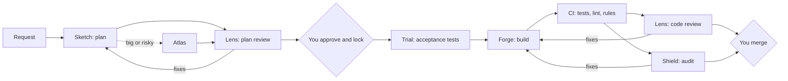

# Expert Bot Development Team: Vision and Proof of Concept

## Vision
A small team of expert bots, each owning one question, takes work from idea to merged PR. You set direction and hold two gates: **approving the plan** and **merging the PR**. Everything in between is planned, built, tested, and reviewed by bots, and quality is enforced by tests, CI, and repo rules rather than by trusting the bots.

**Principles**
1. **You decide what and why.** Bots decide how, within a locked plan.
2. **Checks live in code.** Tests, lint, CI, and branch rules do the enforcing. Bot instructions are a backup.
3. **Separate makers from checkers.** Whoever builds something never approves it. Reviewers can block but can't edit.
4. **Tests come before code.** Acceptance tests are written from the plan first, and the build has to make them pass.
5. **Add bots only when they earn it.** Each new bot needs a measured reason to exist.

## The full team (target state)

| Bot | Owns the question | Covers |
| --- | --- | --- |
| **Sketch** (Planner) | Are we building the right thing? | Plans, research, restating your goal, contracts between layers |
| **Atlas** (Architect) | Will it hold up? | Design, scale, robustness, performance, for big or risky plans |
| **Forge** (Build manager) | Is it built to plan? | Building, or splitting work across specialists and integrating it |
| **Trial** (Quality) | Can we trust it? | Acceptance tests first, coverage, flaky tests |
| **Shield** (Auditor) | Is it secure and private? | Secrets, auth, input handling, vulnerable dependencies, personal data |
| **Lens** (Reviewer) | Does it match the plan and work? | Plan review, code review, bugs, contracts, diff vs. plan |
| **Sweep** (Steward) | Is the codebase staying healthy? | Hygiene, dead code, dependencies, docs, cost, bot drift |

**Build specialists under Forge**, added only when tasks need them: **Pixel** (frontend), **Core** (backend and services), **Vault** (data), and **Relay** (infrastructure, guarded files only when the plan names them).

**Advisor** is not in the build path. It sits outside the per-task flow and only surfaces opportunities for you to choose.
## How a task flows

1. **Sketch** writes the plan: your goal restated in its own words, scope, steps, files, contracts between layers, acceptance tests, and size.
2. **Lens** reviews it, and so does **Atlas** if it's big or risky. Each names at least one way the plan could be misreading your intent.
3. **You approve.** The plan is committed to `plans/`, and that commit locks it.
4. **Trial** writes the acceptance tests from the plan. They must fail before the build.
5. **Forge** builds on its own branch until the tests and CI pass, then opens a PR that links the locked plan commit.
6. **Lens** (code review) and **Shield** (security and privacy audit) review at the same time.
7. **You merge.**

Every review loop is capped at 2 rounds; anything unresolved comes to you. Only you can accept a risk a reviewer flagged. Changing scope or a contract means going back to step 1.

## Proof of concept

**Question it answers:** do a few expert bots produce mergeable PRs for less of your time than building them yourself, without losing quality?

**What it tests:** the bots' judgment and the guardrails. Routing between bots is done by Slopbot by hand in this phase, so it doesn't test full automation yet.

**Team for the proof of concept:** Sketch, Lens, Trial, and Forge working solo. Shield joins only for tasks that touch auth, secrets, or personal data. Atlas, the specialists, and Sweep wait for the roadmap.

### Phase 0: Setup and baseline (days 1–2)
- Pick one repo with decent tests and CI.
- Pick 8 small, real tasks: bug fixes, small features, and refactors or test additions.
- Before any work starts, estimate your hands-on time for all 8.
- Build 3 of them your usual way and log your real time, which also checks how accurate your estimates are.
- Set up the repo rules:
  - Branch protection on `main`, so only you can merge.
  - A code-owners rule requiring your approval for `.github/`, `bots/`, `plans/`, and dependency files.
  - Cursor privacy mode on, and secrets kept out of anything the bots can read.

### Phase 1: Planning (days 3–5, current plan)
- Sketch and Lens plan the 5 remaining tasks. Your extension builds the approved plans.
- Track how many plans you approve as-is, what Lens catches, and your minutes per plan.
- **Go or no-go:** at least half of the plans must be usable without a heavy rewrite. Otherwise, fix the instructions before spending money.

### Phase 2: Building (days 6–12, Cursor Premium at $30/month)
- Before starting, price one task end to end and set a spending cap. Models other than Grok are billed per use on top of the plan.
- Add Trial and Forge. Run the remaining tasks through the full flow. Shield joins only where it's needed.
- Re-run one baseline task near the end and compare to the original.

### Phase 3: Results (days 13–14)
A one-page report:

| Metric | Win if |
| --- | --- |
| PRs merged without you rewriting code | 60% or more |
| Your hands-on minutes per task | Under half of your estimate |
| Bugs or reverts after merge | No worse than your usual |
| Cost per merged PR | Less than your time is worth |
| Real issues caught by reviewers | At least 1 per 3 tasks |
| Guardrail triggers, drift caught, and problems that slipped through | Listed with examples |

A win means the next step is a bigger trial and adding bots from the roadmap, not declaring the system finished.

## Guardrails
- Bots work only on their own branches. Only you merge to `main`.
- No force-pushes. Changes to CI, `bots/`, `plans/`, secrets, `.env`, or dependencies need your approval through the code-owners rule, unless the locked plan names them.
- Every PR links its locked plan commit, and the plan's acceptance tests must exist and pass.
- PRs over about 300 changed lines or 10 files get split.
- A spending cap, a per-task budget, and 2 rounds per review loop.
- Bots never send messages, post, or touch production.

## Drift protections
- **Locked plans:** builders can't change scope; a wrong plan goes back to Sketch.
- **Diff vs. plan:** Lens flags any file changed outside the plan.
- **Intent check:** each plan restates your goal, and you approve that restatement.
- **Versioned instructions:** bot instructions live in `bots/` and change only with your approval.
- **Canary:** one baseline task is re-run periodically (once in the proof of concept, then weekly by Sweep).
- **Rules into code:** anything you correct twice becomes a test or lint rule.

## Known limits
- **Shared blind spots:** bots running on similar models can miss the same things. Your plan approval and merge review are the backstop.
- **Tests only prove what they cover.** Lens flags new code that has no tests.
- **Things CI can't see:** performance, UX, accessibility, and behavior with real data. Each PR has a short manual checklist.
- **Small sample:** 8 tasks shows the approach can work, not that it always will.
- **Rubber-stamping:** read one PR closely each week, even when things go well.
- **Hidden costs:** log your review time and failed runs from day one.

## Roadmap
Each step is added only once the proof of concept or later usage shows it's needed.
1. **Shield on every PR** once the repo handles real user data.
2. **Atlas** once plans regularly span multiple layers or have scale or performance risk.
3. **Build specialists** (Pixel, Core, Vault, Relay) once Forge's solo work shows a recurring weak layer.
4. **Sweep** once there are enough merged PRs to maintain, taking over the weekly canary and drift reports.
5. **Advisor** once Sweep has a few weeks of data. It writes a short weekly brief of 3–5 ranked opportunities (future issues and improvements) with evidence and rough size. Sources: Sweep's patterns, recurring Lens/Shield findings, Trial's coverage gaps, deferred debt in locked plans, and later the product analyst's user signals. It recommends only; you choose what to pursue, and Sketch turns picks into plans.
6. **Coordinator** once several tasks run in parallel. It routes work and tracks status (the project management work) and makes no decisions about the work itself.
7. **Product analyst** once there are real users or a steady stream of issues. It writes you a weekly brief from feedback, issues, and usage data. Advisor can use that brief as an input; decisions stay with you.

## Needed to start
- The repo
- The 8 tasks (or I can pull candidates from its open issues)
- A go-ahead for Phase 0
